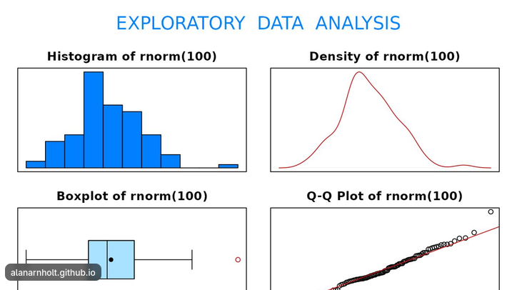
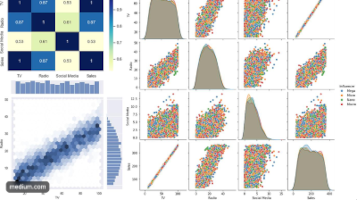
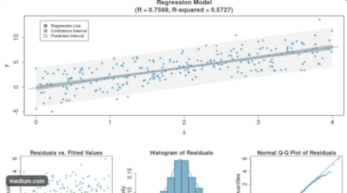
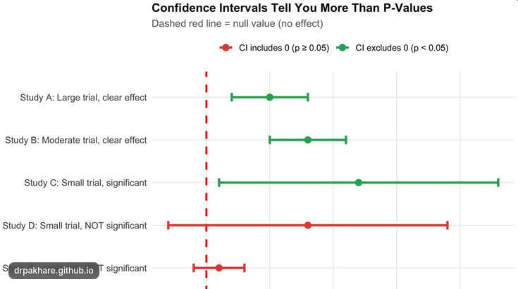
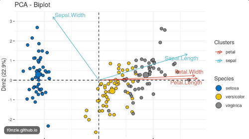

The Python R HTML reports and Tableau dashboards published online at zrydys.GitHub.io/c/sci are gradually being enhanced using statistical analysis. 

This page summarizes how Zrydys goes beyond descriptive statistics with genuine statistical analysis. This moves recent reports from mere averages into distributions, relationships, trends, uncertainty and analyzing patterns.

### Enhancing reports with statistical outputs

| Statistical capability        | outputs examples                                                                      |
| ----------------------------- | ------------------------------------------------------------------------------------- |
| Descriptive statistics        | Mean, median, standard deviation, variance, percentiles, distributions                |
| Distribution analysis         | Histograms, density plots, skewness, outliers, normality assessment                   |
| Correlation analysis          | Pearson/Spearman correlations, correlation matrices, relationships between variables  |
| Regression analysis+          | Linear/logistic regression, coefficients, explanatory variables, model interpretation |
| Hypothesis testing+           | Confidence intervals, p-values, t-tests, chi-square tests, ANOVA                      |
| Time-series analysis+         | Trends, seasonality, moving averages, forecasting                                     |
| Multivariate analysis*        | PCA, clustering, factor analysis, multiple regression                                 |
| Data quality and uncertainty* | Missing values, sampling bias, confidence intervals, sensitivity analysis             |

Not every project needs all these analytical methods, just the appropriate  ones for the questions being investigated.

### Five things to specifically report on

1. Data exploration and distributions

 
  source: https://alanarnholt.github.io/PASWR2/reference/eda.html 

 histograms, boxplots, density plots, outlier detection and distribution interpretation.  Beyond simple averages

2. Correlation and relationships

source: Visualization with Python Seaborn by Çağlar Laledemir/Medium  
 scatterplots, correlation matrices and explanations of relationships between variables.  analytical reasoning

3. Regression and statistical modelling

source: Linear Regression Using Gradient Descen by Dev Khadka /Analytics Vidhy 

Report on model coefficients, explanatory variables, confidence intervals, residual diagnostics and interpretation.  evidences

4. Hypothesis testing and uncertainty

source: drpakhare.github.io/biostat-course/modules/08-statistical-inference.html?utm_source=ZryDys.Github.io Statistical Inference — Confidence Intervals and Hypothesis Testing – Biostatistics for Clinicians 

Adding explicit hypotheses, test statistics, p-values, confidence intervals and conclusions. evidences

5. Multivariate and clustering analysis

  Principal Component Analysis  Machine Learning Compilation 

Using PCA, clustering, segmentation, dimensionality reduction and identification of underlying patterns.  Advanced evidence

### Moving from the useful analytics baseline

Common baselines to start with on analytical activities include :

- Calculating average, minimum, maximum and totals.
- Producing pie charts, bar charts and line graphs.
- Showing monthly or yearly aggregated figures  
- Calculating percentages and growth rates without 
- dashboards with KPIs 

Next we go  towards  substantial statistical analysis : next

### into getting insights from statistical analysis

This is how ZryDys moves forward: analyse trends,  interpret the underlying patterns, investigate relationships or explain findings,  ---
 

1. Exploratory data analysis: distributions, outliers, missing values and data quality.
2. Statistical relationships: correlations and regression models.
3. Statistical inference: hypothesis testing and confidence intervals.
4. Trend analysis: identification and interpretation of temporal patterns.
5. Multivariate analysis: identification of relationships across several variables.
6. Interpretation: explaining what the results mean for a business, research or operational decision.
 
Also each methodology has limitations, not just merely showing numbers.
 